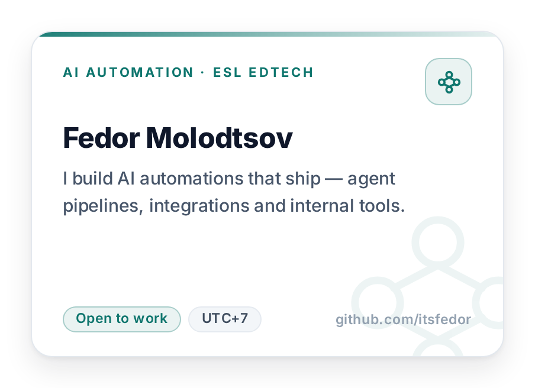
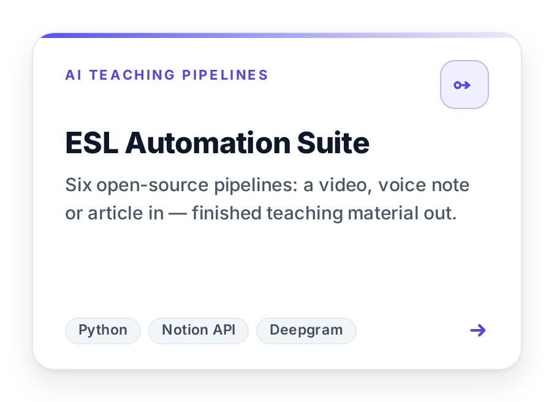
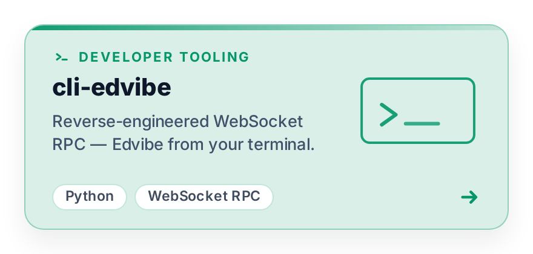
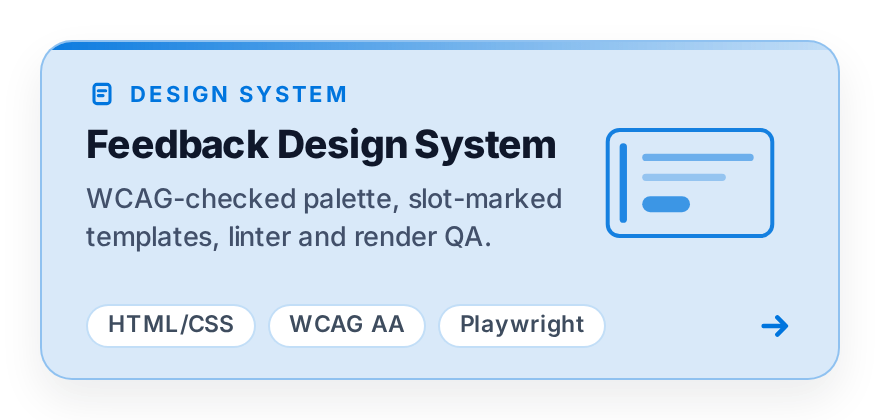
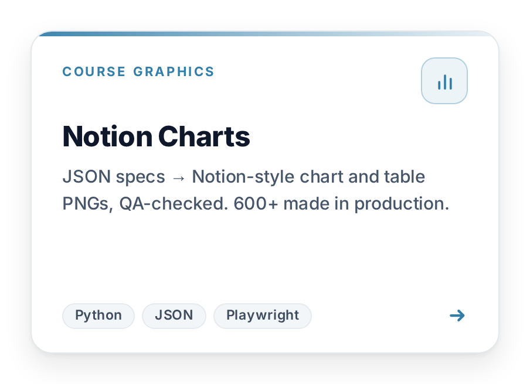
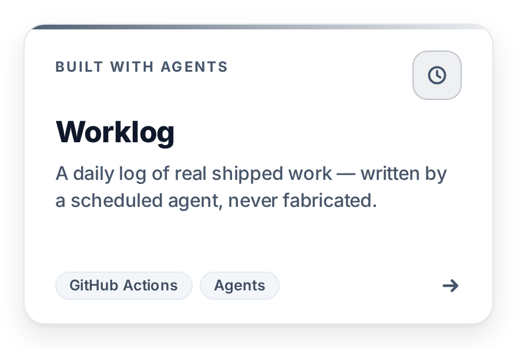

  <picture><source media="(prefers-color-scheme: dark)" srcset="assets/cards/about-dark.png"></picture>
  <a href="https://github.com/itsfedor/esl-automation-suite"><picture><source media="(prefers-color-scheme: dark)" srcset="assets/cards/esl-automation-suite-dark.png"></picture></a>
  <a href="https://github.com/itsfedor/cli-edvibe"><picture><source media="(prefers-color-scheme: dark)" srcset="assets/cards/cli-edvibe-dark.png"></picture></a>
  <a href="https://github.com/itsfedor/esl-feedback-design-system"><picture><source media="(prefers-color-scheme: dark)" srcset="assets/cards/esl-feedback-design-system-dark.png"></picture></a>
  <a href="https://github.com/itsfedor/notion-charts"><picture><source media="(prefers-color-scheme: dark)" srcset="assets/cards/notion-charts-dark.png"></picture></a>
  <a href="https://github.com/itsfedor/worklog"><picture><source media="(prefers-color-scheme: dark)" srcset="assets/cards/worklog-dark.png"></picture></a>

<h1 align="center">Fedor Molodtsov · AI Automation Engineer</h1>

  I build AI automations that ship — agent pipelines, integrations and tools that replace hours of manual work.

Everything in this account runs in production for a private ESL teaching practice
(thousands of lessons delivered): lesson generators, a voice-note → Notion student
tracker, AI-scored Minecraft plugins, interactive web demos.

**Currently building:** a video → lesson-guide pipeline (Deepgram transcription → normalizer → teacher's-guide generator) and an Edvibe lesson-building agent.

**Open to:** contract AI-automation work and remote roles (UTC+7).

  
  
  
  
  

## Selected projects

| Project | What it does | Proof | Stack |
|---|---|---|---|
| [**ESL Automation Suite**](https://github.com/itsfedor/esl-automation-suite) | AI teaching pipelines: lesson-guide generator, voice → Notion student tracker, video-review summaries (Deepgram), TV-episode homework, Edvibe lesson builder | 6 pipelines · 3 installable agent skills | Python · LLM APIs · Notion · Deepgram |
| **ESL Minecraft plugins** — [chat2earn](https://github.com/itsfedor/chat2earn) · [englishprogression](https://github.com/itsfedor/englishprogression) · [vocabquiz](https://github.com/itsfedor/vocabquiz) · [dailyenglish](https://github.com/itsfedor/dailyenglish) | 4 PaperMC plugins that turn a Minecraft server into an English classroom: AI-scored chat payouts, earnings-driven level-ups, vocab quizzes, daily tasks | 4 plugins · ~2,500 lines of Java · Vault + LuckPerms | Java · PaperMC · Groq |
| [**Worklog**](https://github.com/itsfedor/worklog) | Daily log of what actually shipped, written by a scheduled agent | machine-readable · one entry per workday | Automation |

## Recent activity

<!-- WORKLOG:START -->
- **2026-10-23**: Progress levels were rebuilt on live course data — a read-only lesson scan now anchors each of the six student cards, a quarter can no longer drop below its starting level, and goals are counted in lessons (64 with regular homework, 96 with rare) instead of months; the deployed page verified byte-identical with its API closed at 401, and 15.7k community messages were separately ranked into 10 ESL teacher pain points.
- **2026-10-22**: Built an answer-engine visibility tracker (15 prompts, 90 citation slots, JSONL history) and audited 15 distribution surfaces against a 0/15 baseline; the teacher dashboard got a production student progress card backed by a 4.6k-answer analysis DB, tariffs unified on one canon, and a referral free-trial flow at 91/91 booking QA.
- **2026-10-21**: A private desktop app's CI bill went to near zero — self-hosted Mac runner, hosted minutes only on tags, screen QA on a free Linux job, and an in-app updater served from a Pages function — v0.4.2 → v0.4.6; two B2 lessons shipped the same day, one an article-hunt rebuild around three Gmail mocks with 19 article errors, both verified in the live editor.
- **2026-10-20**: The public site's checkout was rebuilt around a single product catalog — every SKU now bills with its own name and a unique invoice id, the result callback journals each order and sends Meta Purchase with content ids (idempotent, forged signatures rejected with 401), and the thank-you page shows the order only after its own status endpoint confirms payment — 13/13 test payments matched; a private desktop app went from its first commit to v0.4.1 in the same day (34 commits, 17 releases).
- **2026-10-19**: The itsfedor.cc teacher dashboard became a product of its own — rebranded «Дашборд» with its own mark and a full visual restyle of its Ученики / Уроки tabs, an active-hours selector and corrected time placement in the calendar, and real lesson accounting (paid / unpaid / planned, manual rows locked against the nightly import) — 55/55 local and 49/49 production QA; a web-analytics audit revived a dead /offer/ goal and confirmed counters on all five public pages; and the site gained its own VPS ops layer — five-minute uptime checks, hourly traffic and lead alerts, a weekly digest, nightly Cloudflare KV backups and weekly Hetzner snapshots, all on systemd timers.
<!-- WORKLOG:END -->

_Appended by a scheduled agent when there's real work to log. Full history: [worklog](https://github.com/itsfedor/worklog)._

## Get in touch

- GitHub: [@itsfedor](https://github.com/itsfedor)
- Telegram: [@itsfedor](https://t.me/itsfedor)
- Open to AI-automation and EdTech collaborations. Pick a repo, check the README, and let's talk.
