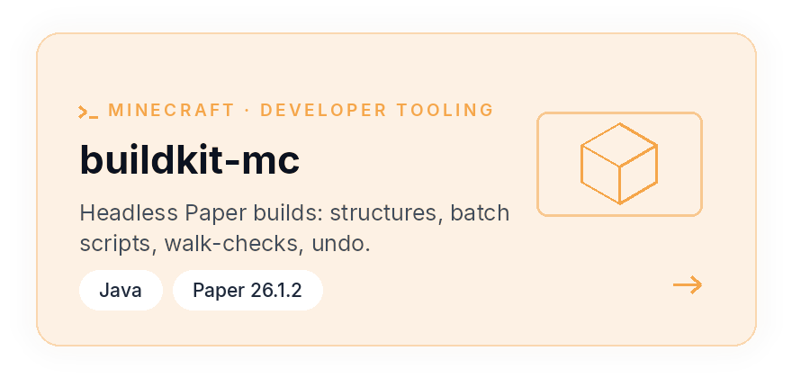
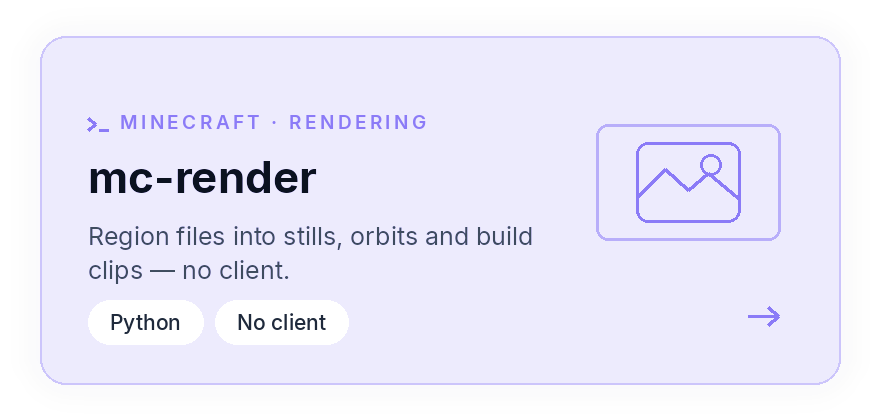

  <picture><source media="(prefers-color-scheme: dark)" srcset="assets/cards/about-dark.png"></picture>
  <a href="https://github.com/itsfedor/esl-automation-suite"><picture><source media="(prefers-color-scheme: dark)" srcset="assets/cards/esl-automation-suite-dark.png"></picture></a>
  <a href="https://github.com/itsfedor/cli-edvibe"><picture><source media="(prefers-color-scheme: dark)" srcset="assets/cards/cli-edvibe-dark.png"></picture></a>
  <a href="https://github.com/itsfedor/buildkit-mc"><picture><source media="(prefers-color-scheme: dark)" srcset="assets/cards/buildkit-mc-dark.png"></picture></a>
  <a href="https://github.com/itsfedor/mc-render"><picture><source media="(prefers-color-scheme: dark)" srcset="assets/cards/mc-render-dark.png"></picture></a>
  <a href="https://github.com/itsfedor/esl-feedback-design-system"><picture><source media="(prefers-color-scheme: dark)" srcset="assets/cards/esl-feedback-design-system-dark.png"></picture></a>
  <a href="https://github.com/itsfedor/notion-charts"><picture><source media="(prefers-color-scheme: dark)" srcset="assets/cards/notion-charts-dark.png"></picture></a>
  <a href="https://github.com/itsfedor/worklog"><picture><source media="(prefers-color-scheme: dark)" srcset="assets/cards/worklog-dark.png"></picture></a>

<h1 align="center">Fedor Molodtsov · AI Automation Engineer</h1>

  I build AI automations that ship — agent pipelines, integrations and tools that replace hours of manual work.

Everything in this account runs in production for a private ESL teaching practice
(thousands of lessons delivered): lesson generators, a voice-note → Notion student
tracker, AI-scored Minecraft plugins, interactive web demos.

**Currently building:** a video → lesson-guide pipeline (Deepgram transcription → normalizer → teacher's-guide generator) and an Edvibe lesson-building agent.

**Open to:** contract AI-automation work and remote roles (UTC+7).

  
  
  
  
  

## Selected projects

| Project | What it does | Proof | Stack |
|---|---|---|---|
| [**ESL Automation Suite**](https://github.com/itsfedor/esl-automation-suite) | AI teaching pipelines: lesson-guide generator, voice → Notion student tracker, video-review summaries (Deepgram), TV-episode homework, Edvibe lesson builder | 6 pipelines · 3 installable agent skills | Python · LLM APIs · Notion · Deepgram |
| **ESL Minecraft plugins** — [chat2earn](https://github.com/itsfedor/chat2earn) · [englishprogression](https://github.com/itsfedor/englishprogression) · [vocabquiz](https://github.com/itsfedor/vocabquiz) · [dailyenglish](https://github.com/itsfedor/dailyenglish) | 4 PaperMC plugins that turn a Minecraft server into an English classroom: AI-scored chat payouts, earnings-driven level-ups, vocab quizzes, daily tasks | 4 plugins · ~2,500 lines of Java · Vault + LuckPerms | Java · PaperMC · Groq |
| **CLI tooling** — [cli-langlisto](https://github.com/itsfedor/cli-langlisto) · [cli-edvibe](https://github.com/itsfedor/cli-edvibe) | Terminal tools for the teacher workspace: students, classes, schedule, materials, and a spec-driven lesson builder; both ship a bundled agent skill | unofficial, reverse-engineered · 17 exercise types | Python · RPC · agent skills |
| **Minecraft build tooling** — [buildkit-mc](https://github.com/itsfedor/buildkit-mc) · [mc-render](https://github.com/itsfedor/mc-render) | A Paper plugin that turns "build this district" into one `/bk` command (structures with rotation, tick-batched scripts, walk-checks, snapshots, undo) and a renderer that turns region files into stills, orbit clips and build-growth GIFs without a client | 3,421 lines of Java · 3,942/3,942 blocks verified on a live server · 8/8 walk-checks | Java · PaperMC · Python |
| [**Worklog**](https://github.com/itsfedor/worklog) | Daily log of what actually shipped, written by a scheduled agent | machine-readable · one entry per workday | Automation |

## Recent activity

<!-- WORKLOG:START -->
- **2026-10-29**: Meta pixel unblocked in the CSP and verified on the live header; JSON-LD shipped on four pages (Person, WebSite, Service, Product, CollectionPage) with an IndexNow key and three engines accepting the ping; the timetable sync went from daily to every three hours behind a no-LLM timer, and the dashboard prediction block was hidden behind a single reversible flag.
- **2026-10-28**: Three answer keys (19 article corrections, each with the why and spoken variants) shipped into a B2 lesson and read back clean over 11 exercises; a lesson section now renumbers in one `SaveExercisesPosition` call, and the daily dashboard deploy was restored with an npx wrangler shim.
- **2026-10-27**: Two new public repos shipped — `buildkit-mc` (headless-build Paper plugin) and `mc-render` (region files into stills, orbits and clips); licences standardised across 15 repos, MIT by default with Apache-2.0 on four flagships, and CI now runs in 10 repos with Dependabot in 6.
- **2026-10-26**: Trial booking on itsfedor.cc went free for everyone — instant confirmations, no payment step, both offers re-editioned (46/46 free-mode, 91/91 paid-mode QA) — and BuildKit, a 23-class Paper plugin for headless builds, shipped `/bk` structure saves, rotations, tick-batched scripts, walkchecks and undo: 6/6 acceptance criteria, live at TPS 20.
- **2026-10-25**: Progression split into two axes — rank from lifetime earnings, CEFR only from a 25-question `/cefr` placement test with listening audio — 13 NPC quests that hung forever now close, and a headless `mcbuild` CLI cuts world regions into datapacks (a mirrored gate matched 1,763 of 1,792 cells).
<!-- WORKLOG:END -->

_Appended by a scheduled agent when there's real work to log. Full history: [worklog](https://github.com/itsfedor/worklog)._

## Licensing

- **Code** — MIT across my repositories, except the four flagship projects
  (ESL Automation Suite, cli-langlisto, notion-charts, feedback design system),
  which are **Apache-2.0** with an explicit patent grant.
- **Teaching materials** — lesson plans, books, exercises and the charts and
  templates built for them are **CC BY-NC-SA 4.0**: free for teachers, no
  resale, credit required.
- **Cases** — three worked examples with numbers: [CASES.md](CASES.md).

## Get in touch

- GitHub: [@itsfedor](https://github.com/itsfedor)
- Telegram: [@itsfedor](https://t.me/itsfedor)
- Open to AI-automation and EdTech collaborations. Pick a repo, check the README, and let's talk.
